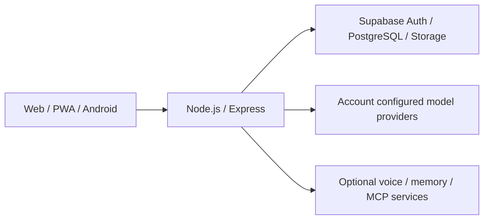

# DengTa Home · 灯塔的家

面向成年用户的 AI 陪伴应用，围绕持续对话、个性化角色、长期记忆与共同活动构建。用户独立选择模型供应商、设置伴侣档案与个性化指令，并在聊天、日记和日常互动中积累关系与经历。

An AI companion app for adults, built around continuous conversation, personal characters, long-term memory, and shared activities. Self-host the web/PWA client and Android app with your own backend, Supabase project, and model providers.


## 下载与体验

- [网页体验](https://www.dengtahome.com/)
- [Android 2.10.71 测试版及更新说明](https://github.com/DengTaHome/dengta-home/releases/tag/v2.10.71)
- [项目简介](docs/PROJECT-INTRODUCTION.md) · [自行部署](docs/DEPLOYMENT.md)

Android 下载版连接灯塔的现有服务；公开源码采用自托管配置，部分装饰标识使用独立绘制资源，需要填写自己的服务地址。此版本是测试发布，真机与生产全流程仍需验收。请先阅读 Release 中的签名、升级和验证说明。

## 项目介绍

DengTa Home 将聊天、记忆、动态状态、日记、语音和可选的设备互动放在同一个日常空间中。每个账号独立配置模型、伴侣名称、个性化指令和记忆；不同伴侣和会话拥有各自的上下文范围。

这是持续开发中的自托管项目。公开仓库提供源码、数据库 SQL 与部署说明；使用者需要配置自己的认证、数据存储、模型接口及可选服务。仓库中的演示角色与测试资料应保持虚构，不应包含实际账号、真实聊天或私密用户材料。

## 主要能力

| 能力 | 使用方式 |
| --- | --- |
| 多模型聊天 | 配置账号自己的模型接口，管理会话，使用流式回复、引用、回复建议和附件 |
| 个性化与记忆 | 保存用户详情和个性化指令，管理伴侣档案、记忆与会话背景 |
| 日常陪伴 | 使用动态、日记、成长状态、天气与共同活动 |
| 自然互动 | 使用贴纸、语音和可见心声等交互界面 |
| 外部能力 | 按需配置语音、外部记忆和 MCP 服务，并明确授权工具 |
| 多端体验 | 使用浏览器/PWA，或构建 Capacitor Android App |
| 设备互动 | 在支持的 Android 设备上，经用户授权启用通知、设备活动和实验性屏幕共看 |

功能可用性取决于相应数据库表、模型能力、外部服务、网络和设备权限。源码中包含功能模块，不等于所有生产环境和设备均已完成验收。用户选择的表达方式仍受实际模型供应商及平台策略影响。

## 首次使用

1. 先完成下方自托管配置，打开自己的网页或安装自己的 Android 构建。
2. 注册/登录账号，按部署配置完成邮箱确认。
3. 在设置中填写个性化指令、用户详情与伴侣档案。
4. 在模型供应商配置界面填入自己的接口地址、凭据和默认模型。
5. 回到聊天页开始对话，再按需配置记忆、语音、MCP 和共同活动。

模型 API 费用和服务账号由使用者自己的供应商配置决定。持续对话通过历史与记忆机制保持连续性，实际模型请求仍受供应商上下文窗口与接口能力限制。

## 架构



| 目录 | 内容 |
| --- | --- |
| `frontend/` | React、Vite、PWA 与 Capacitor Android 客户端 |
| `backend/` | Express API、模型调用、记忆、外部服务与后台任务 |
| `backend/supabase/` | 数据库 SQL 与迁移 |
| `docs/` | 项目、部署和资源说明 |
| `scripts/` | 公开发布检查等辅助脚本 |

## 本地开发

需要 Node.js **24.x**、npm、自己的 Supabase 项目和可用模型接口。Android 构建另外需要 Android Studio、Android SDK 与工程要求的 JDK。以下命令使用 Windows CMD，在克隆仓库的根目录开始。

### 1. 准备后端

```cmd
cd backend
npm ci
copy .env.example .env
```

编辑 `.env`，核对至少以下配置：

| 变量 | 用途 |
| --- | --- |
| `SUPABASE_URL` | 自己的 Supabase 项目 URL |
| `SUPABASE_SECRET_KEY` | 仅供服务器使用的高权限 key |
| `SUPABASE_ANON_KEY` | 认证所需的公共 publishable/legacy anon key |
| `FRONTEND_URL` | 允许调用后端的前端 origin；本地通常为 `http://localhost:5173` |
| `AUTH_REQUIRED` | 公开部署保持 `true` |

可选服务和后台任务的全部配置以仓库中的 `.env.example` 为准。密钥保存在本地环境或部署平台的 Secret 管理器中，不提交 `.env`。

### 2. 初始化自己的数据库

先检查 `backend/supabase/` 中的迁移、依赖和目标数据库已有历史，在独立开发库逐份执行所需文件，随后核对 Auth、表权限、RLS、Storage 与账号初始化。不要仅按数字前缀跳过文件，也不要向已有数据库盲目重复执行全部 SQL。生产升级需要明确的备份与回滚方案。

准备完成后，在 `backend/` 中启动服务：

```cmd
npm start
```

后端默认监听 `http://localhost:3000`，健康探针为 `GET /health`。健康响应不替代登录、模型调用、持久化和多账号验收。

### 3. 启动前端

新开一个 CMD 窗口，在仓库根目录执行：

```cmd
cd frontend
npm ci
copy .env.example .env.local
```

编辑 `.env.local`：

```dotenv
VITE_API_URL=http://localhost:3000
VITE_SUPABASE_URL=
VITE_SUPABASE_ANON_KEY=
```

填入自己项目的 URL 与公共 key，并核对 Supabase Auth 的邮件确认/回跳地址。`VITE_*` 会进入浏览器产物，只能使用公共配置；Supabase secret/service-role key、模型 API key 和登录 Cookie 不能放在这些变量中。[Supabase API key 说明](https://supabase.com/docs/guides/getting-started/api-keys)。

```cmd
npm run dev
```

打开终端显示的地址，默认是 `http://localhost:5173`。

### 4. 构建 Android

在前端目录执行：

```cmd
npm run build
npm run android:sync
cd android
gradlew.bat assembleDebug
```

调试构建用于开发测试。正式分发前需要核对发布签名、升级兼容性、真机安装、权限和发布资产。下载来源与验收状态以各版本 Release 说明为准。

## 验证与部署

在前端目录运行：

```cmd
npm test
npm run build
npm run lint
```

在后端目录运行：

```cmd
npm test
npm run check
```

在仓库根目录运行公开发布检查：

```cmd
powershell -ExecutionPolicy Bypass -File scripts/public-release-audit.ps1
```

测试、构建和静态发布检查通过不等于全部生产流程通过。上线前仍需验证实际账号登录、真实模型供应商、Supabase 权限与存储、不同账号/伴侣隔离、设备权限、外部服务及目标设备性能。具体部署要求见 [部署说明](docs/DEPLOYMENT.md)。

## 隐私与反馈

不要向仓库、Issues、Release 或日志提交真实聊天、个性化指令、记忆原文、数据库备份、密钥、登录 Cookie、访问令牌、设备截图或签名材料。复现问题使用虚构数据；附版本、设备/浏览器、步骤、预期行为与脱敏错误码。

供应商拒答、网关错误和不完整流应按来源报告，应用配置不能覆盖外部服务策略。安全问题的报告方式见 [SECURITY.md](SECURITY.md)，贡献说明见 [CONTRIBUTING.md](CONTRIBUTING.md)。

## 许可证与第三方资源

本公开版目录包含 [ISC License](LICENSE)。第三方代码与资源继续适用各自许可证；发布应保留 [第三方归属说明](THIRD_PARTY_NOTICES.md) 与 [资源说明](ASSETS.md)，并核对新增依赖和素材的授权。
