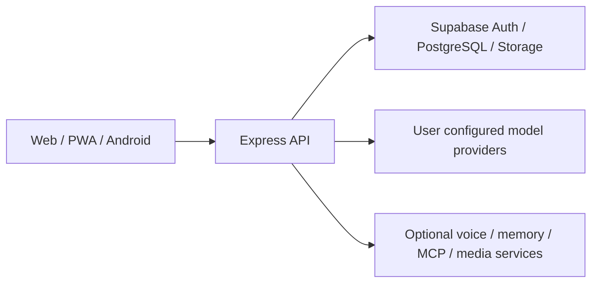

# DengTa Home Backend

DengTa Home（灯塔的家）的服务端，为面向成年用户的 AI 陪伴应用提供持续聊天、个性化、记忆、共同活动、文件与外部工具能力。服务负责将账号、伴侣和会话范围带入数据读取与模型请求，并向配套网页/Android 客户端提供 API。

The backend for DengTa Home, an AI companion app for adults. It connects persistent conversations, personalization, memory, shared activities, and external tools to the web and Android clients.

[配套前端与 Android](../frontend/README.md) · [问题反馈](https://github.com/DengTaHome/dengta-home/issues)

## 架构与能力



| 模块 | 当前源码中的实现 |
| --- | --- |
| 账号与范围 | Supabase Auth 集成、账号/伴侣/会话作用域、租户数据访问与安装通知身份 |
| 聊天与模型 | 流式聊天、会话模型、账号供应商配置、模型目录、工具调用、引用、附件、重试与幂等处理 |
| 个性化与记忆 | 用户指令与详情、伴侣档案、世界书、历史摘要、稳定记忆、可选 Kiwi/Ombre/外部记忆连接 |
| 陪伴与创作 | 日记、动态、活动、成就、纪念日、创作与后台任务 |
| 共同活动 | 共看会话、放映厅与观看记录、音乐库/队列、网易云扫码连接和音乐解读 |
| 文件与工具 | 内容导入、私密媒体、用户工作区、经授权的 MCP 工具及设备信号 |
| 语音与环境 | 可配置语音服务、TTS 与天气代理 |

模型适配包括 OpenAI Chat 兼容接口、OpenAI Responses、Anthropic 与 Gemini。具体模型能力及供应商策略由用户选择的实际接口决定；配置一个协议类型不代表所有网关或模型均已兼容实测。

## 技术栈

- Node.js **24.x**、npm。
- Express **5**，CommonJS，入口 [`server.js`](server.js)。
- Supabase Auth、PostgreSQL 与 Storage，`@supabase/supabase-js`。
- AJV、Multer、Sharp，以及文档/邮件解析依赖。
- Node 原生测试、PGlite 数据库测试与 c8 覆盖率工具。

## 本地启动

使用自己创建的开发 Supabase 项目、自己的模型接口与虚构测试资料。此服务需要数据库和认证配置，不能仅靠 `npm start` 自动创建完整后端。

以下命令使用 Windows CMD：

```cmd
git clone https://github.com/DengTaHome/dengta-home.git
cd dengta-home\backend
npm ci
copy .env.example .env
```

编辑 `.env`，至少核对以下配置。完整模板见 [`.env.example`](.env.example)。

| 变量 | 用途 |
| --- | --- |
| `SUPABASE_URL` | 自己的 Supabase 项目 URL |
| `SUPABASE_SECRET_KEY` | 仅供后端使用的 Supabase secret key；兼容已有环境时使用其 legacy service-role key |
| `SUPABASE_ANON_KEY` | 认证所用的公共 publishable/legacy anon key |
| `AUTH_REQUIRED` | 账号认证要求；公开部署保持启用 |
| `INITIAL_OWNER_EMAIL` | 自己部署的首任管理账号邮箱 |
| `PORT` | 监听端口，默认 `3000` |
| `FRONTEND_URL` | 允许访问 API 的前端 origin；多个地址使用逗号分隔 |
| `MCP_ENCRYPTION_KEY` | 保存 MCP 与相关集成凭据所需的加密密钥 |

数据库建表与 Auth 回跳地址准备完成后启动：

```cmd
npm start
```

健康检查为 `GET http://localhost:3000/health`。健康探针可证明服务可达，但不能替代真实登录、模型调用、存储或多账号验收。随后按[前端说明](../frontend/README.md#本地开发)配置客户端。

Supabase secret/service-role key 只允许位于后端；它具有高权限，不能交给客户端。客户端使用公共 key 和用户会话，并由权限及 RLS 控制数据访问。[Supabase API key 说明](https://supabase.com/docs/guides/getting-started/api-keys)。

## 可选服务

| 能力 | 配置入口与依赖 |
| --- | --- |
| 模型 | 用户在客户端的多供应商 API 控制台中配置接口、凭据与模型 |
| 语音 | 账号语音供应商设置；部署级语音分析使用 `HERVOICE_URL`、`HERVOICE_SECRET`，可选 TTS 见模板和对应文档 |
| 外部记忆 | 账号外部记忆设置；Ombre/Kiwi 等需要相应服务可达 |
| MCP | 用户逐项授权工具；云端连接经后端访问，安装版的本机连接遵守设备侧范围 |
| 网易云与音乐 | 用户授权扫码/账号连接；加密存储、对应迁移、合法资源及可选音乐分析服务 |
| 后台任务 | `BACKGROUND_JOBS_ENABLED` 等；初始化租户、任务租约与恢复机制后再启用 |
| 投屏/设备 | 配对、加密配置、原生插件与设备权限，见 `.env.example` |

网易云当前代码同时包含外部 MCP 互操作与直接扫码/账号会话路径。直接账号连接的敏感会话材料按用户范围加密保管；不要把登录 Cookie 放入仓库、README 或日志。第三方音乐/视频的资源授权、版权、DRM、VIP 和防盗链要求仍由对应服务决定。

## 数据库初始化与迁移

SQL 文件位于 [`supabase/`](supabase/)。当前源码包含 **67 个文件**，编号范围为 `000–061`；`046–050` 中存在重复数字前缀，代表不同迁移，不能仅按数字选择其中一个文件。

初始化或升级前应先核对目标数据库、已应用历史与各文件依赖，再逐份审查和执行缺失的迁移，并检查表权限、RLS、Storage 与必要的账号初始化。使用独立开发数据库验证完整迁移与重复执行行为后，再为自己的部署制定升级方案。这个仓库当前没有一条已经验收的自动全量建库命令。

已有数据库不要盲目重新执行全部 SQL。生产数据库变更应有备份、明确变更范围与回滚方案。当前目录内容不能证明任何运行中的数据库已经应用全部迁移。

## 验证命令

```cmd
npm run check
npm run typecheck
npm test
```

`npm run check` 同时执行 `node --check server.js` 和提示词架构守卫。完整测试入口和所有定向套件见 [`package.json`](package.json)，例如：

```cmd
npm run test:prompt-layers
npm run test:provider-output-guard
npm run test:chat-contract
npm run test:multitenant-db
npm run test:music-listening
npm run test:co-watch
```

测试脚本存在或本地测试通过，不等于生产环境、所有外部供应商和所有设备的端到端流程通过。

## 部署

[`render.yaml`](render.yaml)提供 Render Node 服务配置，使用 `npm ci`、`npm start` 和 `/health` 健康探针。部署到其他 Node 托管环境时使用 Node 24.x，并配置自己的环境变量、HTTPS、前端 origin、数据库权限、Auth 回跳和可选服务。

当前 [`Dockerfile`](Dockerfile)只是一个 Node 22 基础镜像声明，尚未包含完整安装/启动步骤，且与 `package.json` 的 Node 24.x 要求不同；不要把它当作已完成的容器部署方式。

发布前应在自己的部署中验证登录、聊天、流式终止/错误、不同账号与伴侣隔离、文件和音频存储、MCP 授权、后台任务及外部服务。源码公开不表示托管生产服务或调试 APK 已完成全部验收。

## 项目结构

| 路径 | 内容 |
| --- | --- |
| `server.js` | Express 服务入口与共享装配 |
| `routes/`、`routes/v2/` | HTTP API |
| `services/` | 聊天、模型、记忆、媒体、工具及任务逻辑 |
| `supabase/` | 数据库 SQL 迁移 |
| `scripts/` | 检查、评估与辅助脚本 |
| `test/` | 服务与数据库回归测试 |
| `../docs/` | 公开项目介绍与部署说明 |

## 隐私、错误与贡献

用户个性化指令、用户详情、角色档案和记忆属于私密数据。不要将这些原文、真实聊天、账号资料、API key、会话 Cookie、访问令牌或数据库密钥放入代码、测试样本、Issues、Release 或日志。反馈问题时使用虚构数据与脱敏技术信息。

供应商返回错误、拒答或不完整流时，应区分外部供应商/网关错误与 DengTa 本地处理结果。当前代码包含输出与流协议守卫，用于防止失败正文被保存为成功消息或带入后续记忆；这不意味着应用能覆盖外部模型的策略。

在 [Issues](https://github.com/DengTaHome/dengta-home/issues) 中提供版本、接口类型、复现步骤、脱敏错误码/HTTP 状态和预期行为。涉及客户端时附对应前端版本。修改应保留用户数据、现有提示词契约与租户作用域，并运行相关回归检查。

## 许可证与第三方声明

本公开发行版的项目源码适用根目录的 [ISC License](../LICENSE)。第三方代码继续适用各自许可证，须保留 [后端第三方归属说明](THIRD_PARTY_NOTICES.md)。

已存在的第三方授权与互操作说明见 [`THIRD_PARTY_NOTICES.md`](THIRD_PARTY_NOTICES.md)。各依赖仍适用自己的许可证，发布时应保留对应声明。
