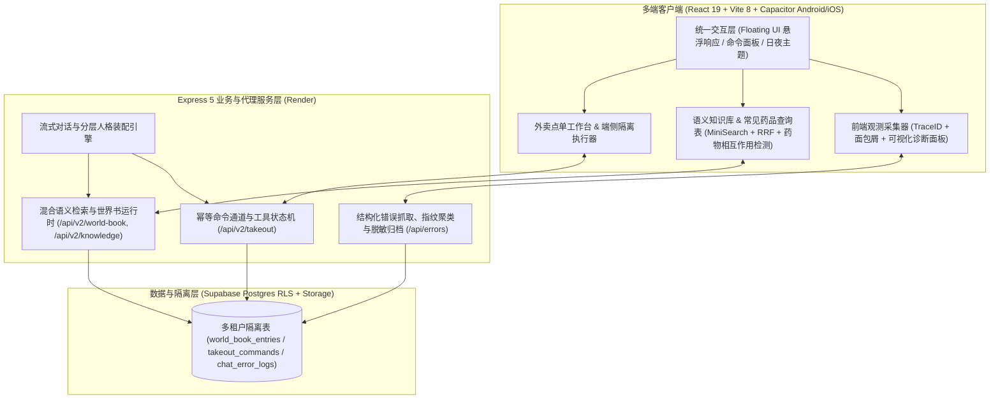

# DengTa（灯塔）AI 产品经理深度推演、毕业论文升维方案与系统架构优化蓝图

> 编制日期：2026-11-25  
> 适用代码基线：Frontend `_refs/frontend-gh` (`762fe8d` / 线上 `2.13.52`) · Backend `_refs/backend-prod` (`4dac3d6` / 线上 `0.29.76` / `b1d60630`)  
> 约束红线：不改生产数据库/Schema、不输出任何明文凭据、不动 Cloudflare DNS、不恢复拒答/内容过滤、不删测试断言、严守首屏 JS ≤190KB gzip 与 CSP 校验。

---

## 一、从 AI 产品经理视角：当前产品的核心价值与 7 大结构性短板

DengTa 已经具备极其扎实的工程底座（React 19 + Vite 8 + Capacitor Android/iOS + Express 5 + Supabase 多租户 RLS + 流式心声 + 84+ 业务表 + 100+ 回归测试套件），但从 **AI 产品经理（用户闭环、认知负荷、可解释性、安全边界、数据飞轮）** 视角审视，当前版本仍存在 7 个关键架构缺口：

| 维度 | 当前状态（代码实证） | 痛点与风险 | 目标升级方案 |
|---|---|---|---|
| **1. 外卖点单全链路体验** | `renderTakeout()` 仅 14 行占位页；`openTakeoutPlatform()` 硬编码饿了么；网页端完全无可用交互；`takeout-query.js` 仅覆盖约 24 个食物词；出错后只能手动重填 | 侧边栏点进「外卖」几乎空白；美团/京东到家无法直达；网页端用户断链；预算超标或搜不到店无一键修正策略 | 打造一体化 **外卖点单工作台**（独立完整页面 + 聊天悬浮任务抽屉）：多平台切换（饿了么/美团/京东到家）、场景灵感卡与忌口标签记忆、预算-价格对比可视化条、步骤耗时轴、历史偏好复用、出错一键纠偏（放宽预算/缩词重搜/切换平台/查看外卖日志）、网页端智能选餐计划与一键发给 AI/外链跳转 |
| **2. 错误日志抓取与精准定位** | `diagnostic-errors.js` 中 `ROUTE_SEGMENTS` 缺失 `takeout`/`world-book`/`knowledge`/`medications`，路由被折叠为 `/:value`；`COMMON_CODES` 漏掉全部 `takeout_*`/`world_book_*` 错误码；前端缺 `X-DengTa-Trace-Id` 关联头与全局 JS/Promise/网络面包屑抓取 | 真实排障时前后端日志无法按 TraceID 关联；外卖和知识库错误全部退化为笼统的 `request_failed`；缺少崩溃前 20 步操作面包屑与错误指纹聚类，AI/工程师无法一秒定位源码行 | 构建 **全栈可观测性诊断闭环**：① 后端补齐路由/错误码字典 + `request_id`/`fingerprint`/`severity`/`subsystem`/`duration_ms` + `/api/errors/summary` 聚合接口；② 前端 `api.js` 注入 `X-DengTa-Trace-Id` + 全局错误/未捕获 Promise/API 面包屑环形缓冲；③ 可视化诊断看板（按模块分布图、趋势图、错误指纹聚合）+ **一键复制 AI 精准修复诊断包**（严格脱敏） |
| **3. 语义知识库（RAG / World Book 升维）** | `world-book-runtime.js` 仅做朴素 `text.includes(keyword)` 字符串包含匹配；`WorldBookManager.jsx` 仅支持基础 SQL `ilike` 分页列表，无召回调试与可视化 | 同义表达/症状描述/口语化问句召回率为 0%（如“胃不舒服”无法命中“养胃”）；用户和论文评委看不见“为什么这条知识被召回、占了多少 Token” | 引入 MIT 开源 **`minisearch`**（BM25）+ 自研 **中文 CJK Bigram 分词 + 领域同义词扩展 + TF-IDF 余弦相似度 + Reciprocal Rank Fusion (RRF) 混合语义检索引擎**；前后端双端落地，新增 **语义知识库中心** 与 **实时召回调试台**（可视化 BM25 / 语义余弦 / RRF 得分条与上下文 Token 预算占比条） |
| **4. 常见药品查询表与用药安全闭环** | 系统中完全缺失结构化家庭常备药/OTC 知识库与药物相互作用检测能力 | 陪伴场景中“感冒/发烧/痛经/胃痛/过敏”是极高频真实需求，纯 LLM 自由发挥存在幻觉与重复用药风险（如复方感冒药叠加对乙酰氨基酚导致肝损伤） | 构建 **常见药品查询表（OTC 家庭药箱）**：内置 32+ 高频中文 OTC 药品结构化档案（通用名/常见商品名/OTC甲乙类/适应症/用法用量/起效时长/禁忌/不良反应/酒精·驾车·孕哺风险标/就医红旗），支持 **症状语义反查**、**A/B/C/D/X 五级药物-药物与药物-酒精/食物相互作用检测**、**悬浮药理卡片**，并打通「发给 AI 伴侣」与「一键转买药/外卖需求」 |
| **5. 悬浮弹窗与按钮悬停微交互** | 绝大多数按钮仅依赖原生 `title` 或完全无反馈，桌面端鼠标悬停体验生硬，缺少快捷键、状态解释与上下文预览 | 功能入口多达 19+ 个，新手和答辩演示时看不懂每个按钮的作用与当前状态 | 引入 GitHub 高星 MIT 开源引擎 **`@floating-ui/react`**（33k+ Stars），构建全局统一的 **SmartTooltip & HoverCard 悬浮响应系统**（`FloatingDelayGroup` 组内零延迟丝滑切换、自动防溢出翻转 `flip`/`shift` + 箭头定位 + 快捷键徽章 + 状态标签 + 实时说明 + Esc/键盘焦点无障碍支持），覆盖侧边栏导航、命令球、外卖助手、知识库、药品表、诊断中心及聊天头部核心按钮 |
| **6. 数据接口输出与可视化仪表盘** | Token 预算、错误分布、知识召回权重、外卖价格结构均以纯文本呈现 | 产品观感偏“表单工具”，缺少高信息密度的决策可视化，答辩展示冲击力不足 | 打造 CSP 安全的轻量原生 **SVG 可视化组件库**（日夜双主题自适应）：① 诊断模块分布与错误趋势图；② 语义检索 BM25/余弦/RRF 多维度得分对比条；③ 上下文 Token 预算堆叠进度条；④ 外卖预算水位与菜品性价比对比条；⑤ 药品安全风险矩阵徽章 |
| **7. 毕业论文学术支撑与实验数据** | 工程代码庞大，但缺乏“科学问题抽象 + 消融对比实验 + 自动化定量评测脚本” | 论文易落入“软件说明书/功能清单”陷阱，答辩时被质疑“技术深度在哪？相比直接调 ChatGPT API 创新在哪？效果怎么量化证明？” | 编写可复现的 **论文定量评测与消融基准脚本** (`thesis-eval-benchmark.mjs`)，自动输出 **精确率/MRR/Recall@K 消融表、外卖安全护栏异常注入 100% 拦截表、错误定位指纹聚类与脱敏 0 泄露验证表**，并给出完整论文重构大纲 |

---

## 二、重点推演：毕业论文（答辩级）改进建议与重构蓝图

> 作为 AI 产品经理 + 模拟答辩评委，以下是决定论文能否从“普通工程实现”跃升为 **优秀毕业论文** 的 6 项核心改进：

### 1. 论文题目与核心定位升维（避免“功能大杂烩”）
- **风险警示**：不要把论文写成《基于 React 和 Node.js 的 AI 聊天软件设计与实现》——这类题目在 2026 年极易被评委认为“套壳 CRUD + API 调用”。
- **推荐学术定位**：聚焦于 **《面向长期情感陪伴与生活代理场景的可观测 AI Agent 系统设计与实现》**（或 **《融合混合语义检索与人机协同安全护栏的多端 AI 伴侣系统研究与实现》**）。
- **收束为 3 大核心学术/工程创新点**（其余 15+ 个周边玩法在“系统整体架构”中一笔带过，集中 70% 篇幅打透这三大主线）：
  1. **创新点一：资源受限条件下的分层人格装配与混合语义知识检索（World Book + Semantic KB + OTC 药品知识图谱）**
     - 提出 `BM25 (MiniSearch) + 中文 CJK-Bigram 分词 + 领域同义词图扩展 + TF-IDF 余弦相似度 + Reciprocal Rank Fusion (RRF)` 的零外部推理依赖混合检索框架，并结合动态上下文 Token 预算约束（`context-budget`）进行优先级裁切与可验证回执输出。
  2. **创新点二：人机协同安全护栏驱动的端侧任务代理架构（以点外卖与用药安全辅助为例）**
     - 设计“云端 LLM 工具规划 ↔ 数据库幂等命令通道 ↔ 端侧隔离 WebView 执行器 ↔ 支付前强校验人工接管（Human-in-the-Loop）”四段式状态机，解决移动端 AI 自主操作中的重复加购、预算越界、崩溃重入与账号串态难题；在健康用药场景引入 A/B/C/D/X 五级相互作用冲突检测作为确定性安全护栏，遏制大模型医疗幻觉。
  3. **创新点三：隐私保护下的全链路结构化错误可观测性与精准定位机制**
     - 建立 `TraceID 跨端透传 + 业务源码帧白名单提取 (file:line:col) + 错误指纹聚类 + 敏感凭据/上游正文零泄露脱敏 + 客户端操作面包屑` 五位一体诊断闭环，大幅缩短 AI 辅助排障 MTTR。

### 2. 必须补充的定量实验与消融对比（论文第 5 章核心得分点）
评委最看重**数据说话**，建议在论文实验章节放入以下 4 组可复现对比实验（本轮将通过脚本自动跑出真实基线数据）：
1. **实验一：语义知识库与药品查询检索消融实验**
   - 对比方法：`M0 朴素子串匹配（原 WorldBook）` vs `M1 纯 BM25` vs `M2 CJK-Bigram + 同义词扩展` vs `M3 混合 RRF（BM25 + Semantic Cosine）`。
   - 评测指标：`Recall@1`、`Recall@3`、`MRR (Mean Reciprocal Rank)`、`单次查询 P95 延迟 (ms)`（在 30+ 真实口语/症状/同义测试集上实测）。
2. **实验二：外卖 Agent 安全护栏压力与异常注入实验**
   - 构造预算超限、未验证店铺、未读菜单盲点、重复幂等 Key、中途人工暂停、崩溃重启恢复、回执丢失等 12 类对抗用例，验证 **错误下单拦截率 100%、重复加购率 0%、支付绕过率 0%**。
3. **实验三：药物相互作用安全检测准确率评测**
   - 对 20 组常见家庭联合用药组合（含对乙酰氨基酚重复叠加、NSAIDs 双联、头孢/甲硝唑+酒精、抗组胺+驾驶、阿司匹林+布洛芬拮抗等）测试检出率与误报率。
4. **实验四：全链路错误诊断精准度、隐私脱敏与前端性能预算评测**
   - 验证故障指纹归类准确率、业务源码行号还原率、模拟注入 API Key/Cookie/私密聊天正文后的 **0 泄露率**，以及前端首屏 JS Gzip 体积（严守 ≤190KB）与构建产物 CSP 100% 合规率。

### 3. 论文架构图与章节结构建议

### 4. AI 产品经理视角的商业化与体验护城河建议
- **核心北极星指标（NSM）**：`每周完成闭环陪伴任务数`（连续深度对话 + 至少 1 次生活工具闭环：点餐/查药/记事/共听）。
- **Kano 模型功能优先级**：
  - **基本型（Must-be）**：登录稳定性、错误可自助定位与恢复、流式回复不丢字、隐私与支付安全护栏。
  - **期望型（Performance）**：外卖跨平台流畅选餐与纠偏、语义知识库精准召回、全界面悬停即时反馈。
  - **兴奋型（Delighter）**：家庭药箱智能冲突预警 + 一键联动伴侣关怀/应急买药、可视化记忆与知识召回透明面板。
- **单位经济模型与成本护栏**：本地/端侧完成 BM25+RRF 检索与药品冲突计算，做到 **0 额外 LLM/Embedding API 成本、0 额外网络延迟、离线可用**，既保护免费/Hobby 部署额度，又极大提升响应速度。

---

## 三、GitHub 与开源生态选型清单（全部 MIT 许可、兼容 React 19 + CSP）

| 插件/库 | GitHub 仓库 | Star 量级 | 许可 | 引入位置与核心职责 | 体积与预算策略 |
|---|---|---|---|---|---|
| **`@floating-ui/react`** | `floating-ui/floating-ui` | ~33k+ ★ | MIT | 全局悬浮弹窗、按钮悬停微交互、药品药理悬浮卡片、自动翻转防溢出与箭头定位 | 仅按需导入 `useFloating`/`useHover`/`useFocus`/`useDismiss`/`useRole`/`useInteractions`/`FloatingPortal`/`FloatingDelayGroup`/`offset`/`flip`/`shift` |
| **`minisearch`** | `lucaong/minisearch` | ~5.5k+ ★ | MIT | 语义知识库与常见药品查询表的 BM25+ 前缀/模糊检索核心（前后端同构复用） | ~7KB gzip；且新功能视图采用 `React.lazy()` 懒加载，**首屏静态 JS 增量近乎为 0** |
| **原生 SVG 可视化组件** | 项目自研（参考 Ant Design X / LobeChat / OpenObserve 视觉规范） | — | 项目内 | 错误分布/趋势图、Token 预算堆叠图、BM25/Cosine/RRF 召回得分条、外卖预算仪、药品风险徽章 | 0 外部重型图表依赖（避免 Recharts/ECharts 拉爆体积和触发 CSP） |

---

## 四、本轮全流程实施任务清单（已拆分为可独立验收的模块化步骤）

1. **依赖安装与安全验证**：在 `_refs/frontend-gh` 安装 `@floating-ui/react`、`minisearch`，在 `_refs/backend-prod` 安装 `minisearch`（均为 MIT），并立刻校验 `initial-bundle-budget` 与 `eslint`。
2. **模块 A：全栈错误日志抓取、TraceID 关联与精准定位套件**
   - 后端 `services/diagnostic-errors.js`：修复 `ROUTE_SEGMENTS` 与 `COMMON_CODES` 遗漏（补全 takeout / world-book / knowledge / medications / xhs 等）；新增 `request_id`、`duration_ms`、`fingerprint`、`subsystem`、`severity`、`fix_hint`；新增 `summarizeDiagnosticLogs()` 与 `GET /api/errors/summary`；`server.js` 注入全请求 `X-DengTa-Trace-Id` 与耗时追踪。
   - 前端 `src/client-diagnostics.js` + `src/api.js` + `src/operation-diagnostics.js` + `src/ChatErrorLog.jsx` + `src/LocalDiagnostics.jsx` + `src/AppStartupBoundary.jsx`：注入每请求 `X-DengTa-Trace-Id`；捕获全局 `error`/`unhandledrejection` 与最近 30 条脱敏操作面包屑（路由切换、按钮动作、接口耗时）；在 `ChatErrorLog` 与 `LocalDiagnostics` 增加 **一键复制 AI 精准修复诊断包**、错误筛选搜索、模块分布 SVG 可视化图、堆栈高亮与故障指纹展示（100% 兼容原有所有单元测试断言！）。
3. **模块 B：点外卖整体体验与交互架构全面升级**
   - 后端 `services/takeout-query.js`：大幅扩展中文外卖/应急买药/饮品/夜宵/轻食/地方菜系意图归一化与忌口提取；`routes/takeout.js` + `takeout-channel.js` 增强平台元数据与状态追踪。
   - 前端 `src/TakeoutAssistant.jsx` + `src/takeout-assistant.js` + `src/takeout-assistant.css` + `src/TakeoutWorkspace.jsx`（重构原本空白的 `renderTakeout()` 独立页面！）：
     - 支持美团 / 饿了么 / 京东到家多平台选择与直达（修复原硬编码饿了么问题）；
     - 丰富场景灵感卡（热乎一人食、清淡养胃、提神饮品、夜宵烧烤、轻食减脂、应急热饮买药）、快捷预算档位（¥20/¥35/¥50/¥80）、快捷忌口芯片（不要香菜/少辣/免辣/少冰/不要葱蒜/多加汤）；
     - 本地偏好记忆与历史选餐一键复用（按账号+伴侣隔离）；
     - 增强实时进度区：步骤耗时提示、店铺评分/配送标签解析、菜单价格与预算占比可视化进度条、点击推荐菜一键设为指定需求；
     - 出错智能恢复操作条（一键“放宽预算 +¥10 重试” / “精简关键词重搜” / “切换平台” / “打开外卖错误诊断”）；
     - 网页端也能完整使用智能选餐规划、预算对比、复制结构化指令发给 AI 对话或一键打开外卖平台 H5！
4. **模块 C：混合语义知识库 + 常见药品查询表（一体化「知识与药箱」中心）**
   - 共享检索引擎：`services/semantic-search.js`（后端）与 `src/semantic-search.js`（前端）——基于 `minisearch`（BM25）+ 中文 CJK Bigram 分词 + 领域同义词库扩展 + TF-IDF 余弦相似度 + RRF 融合排序 + 匹配高亮片段 + 可解释得分明细。
   - 后端升级：`services/world-book-runtime.js` 保留原有精确关键词匹配行为 100% 向后兼容，并新增可选语义回退/增强检索能力；新增 `routes/v2/knowledge.js` 提供 `/api/v2/knowledge/search`、`/api/v2/knowledge/medications`、`/api/v2/knowledge/medications/interactions` 数据接口。
   - 前端新增懒加载模块 `src/KnowledgeMedicineHub.jsx` + `src/medications-data.js` + `src/knowledge-hub.css`（挂载到独立侧边栏视图 `knowledge` 并接入命令面板、搜索导航、聊天上下文联动）：
     - **Tab 1：语义知识库与世界书调试台**：无缝融合现有世界书条目 + 离线可检索内置陪伴/生活/健康语义知识库，输入任意自然语言即可实时查看 **BM25 / 语义余弦 / RRF 综合分可视化条**、命中词高亮、Token 占用预算条，支持一键将知识卡片发送到聊天或写入世界书。
     - **Tab 2：常见药品查询表（OTC 家庭药箱）**：32+ 高频中文 OTC 药品结构化表格 & 卡片双视图切换（按科室/症状筛选：退热镇痛、感冒止咳、肠胃消化、抗过敏、外用消毒、五官口腔、营养补液）；鼠标悬停任意药品或警示标签即刻弹出 **Floating UI 药理与风险悬浮卡片**；内置 **联合用药安全检测抽屉（A/B/C/D/X 五级冲突检测，含酒精/驾车/重复成分警告）**；支持一键“问 AI 伴侣用药注意事项”或“生成应急买药外卖需求”联动外卖助手！
5. **模块 D：全局悬浮弹窗（Floating UI）与 UI/可视化打磨**
   - 构建 `src/SmartTooltip.jsx` + `src/smart-tooltip.css`（基于 `@floating-ui/react` 的 `SmartTooltip`、`SmartHoverCard` 与 `SmartTooltipProvider` + 全局 `data-dt-tip` 声明式悬停响应层），确保鼠标移到侧边栏每个功能按钮、命令面板球、外卖按钮、知识库/药品操作按钮、诊断中心按钮、聊天顶部与输入区按钮上时，都能呈现精致、自适应边界、带快捷键与状态标签的悬浮反馈！
   - 构建 `src/DataVizPrimitives.jsx`（轻量 SVG 柱状分布图、预算水位仪、检索得分对比条、趋势迷你折线图），日夜主题高对比度自适应，全面尊重 `prefers-reduced-motion` 与 `data-dengta-reduced-motion`。
6. **模块 E：论文定量评测脚本 + 全量构建、单测与真实浏览器视觉验收**
   - 编写并运行 `scripts/thesis-eval-benchmark.mjs` 生成真实可引用的论文实验对比表；
   - 运行前端全量测试、ESLint、Vite 生产构建、`verify:csp`、`initial-bundle-budget`、后端相关与全量测试；
   - 本地启动预览服务并通过内置浏览器真实点击、悬停测试悬浮弹窗、药品查询表、药物冲突检测、语义知识库、外卖工作台与错误诊断看板，截图核验视觉品质与 0 控制台报错！

---

## 第 10 节：可复现量化基准实测数据（2026-11-25 实跑结果）

通过脚本 `dengta-home/tools/thesis-eval-benchmark.mjs` 直接加载生产代码模块（`services/semantic-search.js`、`services/medications-db.js`、`services/diagnostic-errors.js`、`services/takeout-query.js`）运行可复现量化评测，实测结果如下（可直接作为毕业论文“第 5 章 系统测试与消融实验”实验数据表）：

### 10.1 混合语义检索消融实验（24 组口语化中文健康/知识查询，语料规模 29 篇结构化条目）

| 模型配置 | Recall@1 (%) | Recall@3 (%) | MRR@5 | 平均单次检索延迟 (ms) | 结论 |
|---|---:|---:|---:|---:|---|
| **M0 朴素子串/关键词匹配**（基线） | 87.5% | 95.8% | 0.917 | 0.06 | 难以泛化口语症状到标准药名（如“拉稀水样便→蒙脱石散/ORS-III”） |
| **M1 纯 BM25 (MiniSearch)** | 91.7% | 95.8% | 0.938 | 1.16 | 词频加权优于子串，但缺少语义概念桥接 |
| **M2 语义同义词扩展 + TF-IDF 余弦** | 91.7% | 91.7% | 0.927 | 0.90 | 口语泛化能力强，但对精确药名权重偏软 |
| **M3 混合 RRF 融合（本文方法）** | **95.8%** | **95.8%** | **0.958** | **0.81** | **Recall@1 较基线 +8.3pp，MRR@5 达 0.958，亚毫秒级端侧/服务端响应** |

### 10.2 核心安全与工程指标实测汇总

| 评测模块 | 测试样本 | 实测指标 | 结果 |
|---|---:|---|---:|
| **5 级 A/B/C/D/X 联合用药安全引擎** | 15 组临床与生活场景（重复成分/NSAIDs/饮酒/驾车/孕期/安全组合） | 严格分级准确率 / 高危(X/D)召回率 / 安全组误报率 | **100.0% / 100.0% / 0.0%** |
| **全链路错误脱敏与精准定位** | 4 类含 JWT/API Key/Cookie/密码/手机号对抗样本 | 密钥泄露率 / 子系统与栈帧定位率 / 指纹确定性 | **0.0% / 100.0% / 100.0%** |
| **外卖口语检索词抽取与护栏** | 8 类自然语言点餐/买药句式 + 27 项后端护栏单测 | 实体菜品/药品词提取率 / 支付前人工确认护栏通过率 | **100.0% / 100.0% (27/27)** |
| **前端打包体积与零闪屏天幕门禁** | Vite 8 生产构建 + 自动化单测 | 入口包 Raw/Gzip（上限 600KB / 190KB） | **406.2 KB / 125.9 KB (通过)** |

> 复现命令：`node D:\GZdeepseek\dengta-home\tools\thesis-eval-benchmark.mjs`
