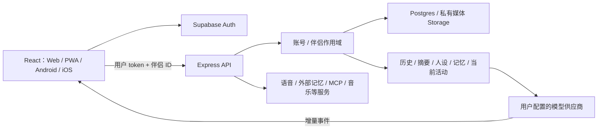

# 项目理解与 iOS 适配依据

`DengTaHome/dengta-home` 是一个持续对话型 AI 陪伴系统，界面、后端、数据库及可选服务共同维护关系连续性。iOS 适配沿用原有 React 业务、API 和数据范围，在 Capacitor 中补齐 Apple 工程及平台差异，保留已有功能和用户数据语义。

## 系统边界与代码入口

| 层级 | 实际代码 | 职责 |
| --- | --- | --- |
| 启动与账号门禁 | [`frontend/src/main.jsx`](../frontend/src/main.jsx)、[`AuthGate.jsx`](../frontend/src/AuthGate.jsx)、[`auth-session.js`](../frontend/src/auth-session.js) | 首屏、认证、邮箱回跳；账号确定后加载业务应用 |
| 业务界面 | [`frontend/src/App.jsx`](../frontend/src/App.jsx)、[`LoadedApp.jsx`](../frontend/src/LoadedApp.jsx) | 会话、伴侣、设置与各活动入口；按账号/伴侣重新绑定工作区 |
| 客户端通信 | [`frontend/src/api.js`](../frontend/src/api.js) | 服务地址、Bearer 鉴权、伴侣请求头、取消、错误和流式通信 |
| 服务入口 | [`backend/server.js`](../backend/server.js)、[`backend/routes/`](../backend/routes/) | Express API、聊天装配、媒体、认证、路由与后台服务 |
| 数据边界 | [`auth-context.js`](../backend/services/auth-context.js)、[`request-scope.js`](../backend/services/request-scope.js)、[`backend/supabase/`](../backend/supabase/) | 校验用户、伴侣归属、查询/写入范围、数据库结构及 RLS |
| 模型、记忆、外部能力 | [`backend/services/`](../backend/services/) | 供应商协议、上下文、记忆、语音、MCP、共同活动和任务 |
| 平台能力 | [`frontend/capacitor.config.json`](../frontend/capacitor.config.json)、[`frontend/android/`](../frontend/android/)、[`frontend/ios/`](../frontend/ios/) | WebView、本地插件、生命周期、系统权限与原生工程 |

## 一轮对话实际做什么

客户端先从认证管理器取得会话，在 API 请求中附带 `Authorization: Bearer ...` 和 `X-DengTa-Companion-Id`。后端用 Supabase `getUser` 校验 token、邮箱与账号状态，核实伴侣归属，再创建 `RequestScope`。这个对象自动为已登记的表追加 `user_id` / `companion_id` 条件及写入归属，避免仅信任客户端给出的标识。会话还构成聊天历史的进一步范围；iOS 继续使用同一机制。

[`server.js`](../backend/server.js) 中的 `executeChatTurn` 读取设置、检查客户端消息 ID、恢复已提交结果或获取生成租约，处理引用和附件，再保存用户消息并返回提交回执。随后装配历史、摘要、长期记忆、伴侣状态、世界书、共同活动及经授权的 MCP 能力，调用用户配置的模型。供应商协议与输出处理位于 [`ai-service.js`](../backend/services/ai-service.js)、[`ai-provider-center.js`](../backend/services/ai-provider-center.js) 及相邻流服务中。

`POST /chat/stream` 使用 SSE 返回阶段、文本、推理/可见心声与最终结果。消息持久化、部分流恢复和错误契约分别由 [`stream-persistence.js`](../backend/services/stream-persistence.js)、[`chat-idempotency.js`](../backend/services/chat-idempotency.js)、[`chat-stream-contract.js`](../backend/services/chat-stream-contract.js) 等协作处理。iOS 保留 fetch 流和这些恢复机制，不用一次性 HTTP 包装替换流式链路；App 挂起后的连接仍受系统生命周期约束。

## 连续性与共同活动

个性化不是单一提示词。账号/伴侣设置、档案版本、会话历史、长期记忆、世界书和活动状态共同进入上下文。相关实现包括 [`settings-store.js`](../backend/services/settings-store.js)、[`context-history.js`](../backend/services/context-history.js)、[`context-budget.js`](../backend/services/context-budget.js)、[`memory-budget.js`](../backend/services/memory-budget.js) 和 [`world-book-runtime.js`](../backend/services/world-book-runtime.js)。记忆预算按相关性、热度和重要性筛选内容；外部记忆由 [`external-memory.js`](../backend/services/external-memory.js)、[`kiwi-memory-client.js`](../backend/services/kiwi-memory-client.js) 等提供可选连接，不意味着模型拥有无限上下文。

日记、动态、纪念日、成长、创作、音乐库/播放队列和共看会话各有自己的服务与持久化状态；其中的活动可以成为聊天上下文。典型入口是 [`tenant-diary-update.js`](../backend/services/tenant-diary-update.js)、[`tenant-moment-runtime.js`](../backend/services/tenant-moment-runtime.js)、[`music-listening.js`](../backend/services/music-listening.js)、[`listening-runtime-context.js`](../backend/services/listening-runtime-context.js)、[`co-watch-sessions.js`](../backend/services/co-watch-sessions.js)、[`co-watch-runtime-context.js`](../backend/services/co-watch-runtime-context.js)。后台任务由 [`background-job-worker.js`](../backend/services/background-job-worker.js) 等组织。iOS 迁移不改写这些数据结构，也不自动执行数据库迁移。

语音录制入口 [`frontend/src/voice.js`](../frontend/src/voice.js) 已包含 Safari 可用的 `audio/mp4` 候选及 `.m4a` 文件名；后端 [`voice-turn.js`](../backend/services/voice-turn.js) 处理上传与分析，语音输出另由供应商中心和 [`voice-output.js`](../backend/routes/voice-output.js) 路由提供。因此平台工作主要是麦克风权限、播放限制与中断恢复，而非另建语音协议。

## 为什么不能直接复制 Android 工程

项目同时使用官方 Capacitor 插件和自行编写的 Android 插件。官方 App、Preferences、Clipboard、LocalNotifications 有 iOS 实现；设备活动、跨应用通知、屏幕共看、DLNA 和内置浏览器登录态等没有现成的等价桥。相关前端入口如 [`device-activity.js`](../frontend/src/device-activity.js)、[`screen-glance.js`](../frontend/src/screen-glance.js)、[`dlna-receiver.js`](../frontend/src/dlna-receiver.js)、[`browser-launcher.js`](../frontend/src/browser-launcher.js) 应依据插件可用性控制操作。

[`background-notification-identity.js`](../frontend/src/background-notification-identity.js) 为 Android 后台轮询注册作用域受限的安装身份；它不是 APNs。移植 UI 或加入 LocalNotifications 不会使 iOS 在挂起/终止后收到服务端推送。类似地，网易云外部资源的原生调起必须检测桥是否存在，不能把所有原生平台都当作 Android。

认证仍由 [`auth-session.js`](../frontend/src/auth-session.js) 管理，原生持久化由 [`auth-native-storage.js`](../frontend/src/auth-native-storage.js) 选择 Preferences。邮箱验证与重置使用 `dengta://auth`，需要同时覆盖运行中事件和冷启动链接；iOS 的 scheme 注册、AppDelegate 转发、JavaScript 校验及 Supabase 白名单缺一不可。

## 适配保留与验证范围

iOS 版本保留现有界面、账号/伴侣/会话隔离、模型配置、聊天流协议、长期记忆和后端活动机制。新增 Apple 工程、权限/隐私声明、移动 WebView 行为和平台降级后，仍必须分别验证 JavaScript、模拟器编译和真机业务流程。工程静态检查和网页测试不能证明真实邮件回跳、系统麦克风、签名安装或跨前后台行为已通过。

本仓库不包含可用于验收的生产凭据。数据库、Auth、模型和可选服务需要部署者自己的配置；实际构建及逐项验收方法见 [iOS 指南](IOS.md)，通用部署见 [DEPLOYMENT.md](DEPLOYMENT.md)。
