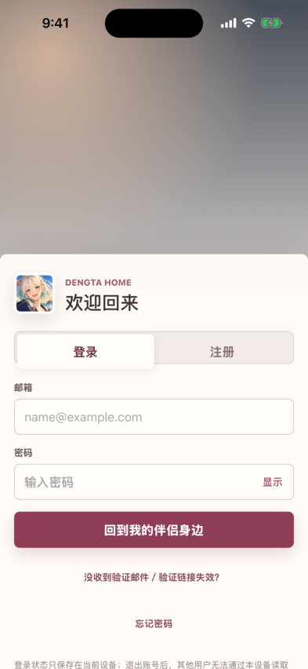
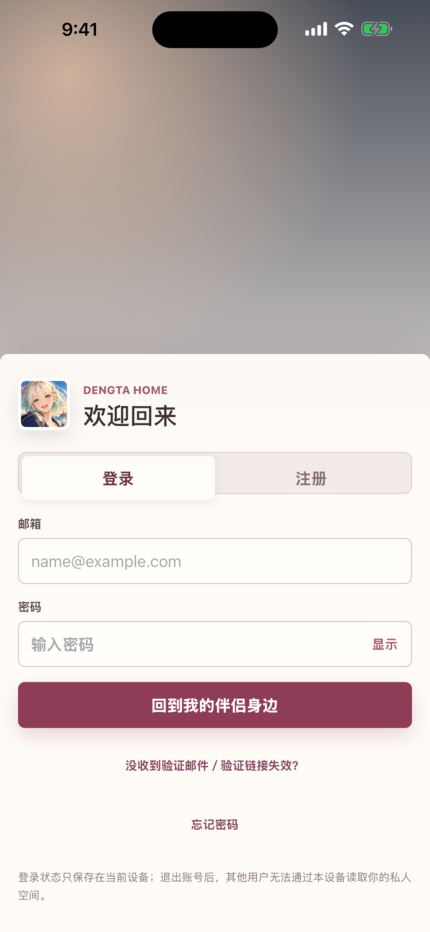

# 第二阶段原生 iPhone 登录截图

以下预览来自 [GitHub Actions run 42985728913](https://github.com/DengTaHome/dengta-home/actions/runs/42985728913)，原图与 manifest 位于 [artifact 13840402981](https://github.com/DengTaHome/dengta-home/actions/runs/42985728913/artifacts/13840402981)。产物按工作流保留 14 天；此目录保留便于源码审阅的预览。

使用 Xcode 26.6、iOS Simulator 26.5（23F77）和虚构公开登录配置，没有真实用户账号、聊天数据或凭证。源分支提交为 `b09a65d50b78c24235ceba2e10638df24f8a808d`，实际构建的 PR 合并提交为 `5d7f7a8fecf919b546d9c72d21baafa547a1bf81`。

预览仅按各机型的逻辑屏幕宽度等比缩小、去除文件元数据并压缩 PNG，**没有裁切、重绘或改动 UI**。缩小后的图片不是逐像素比较基准，原始尺寸和 SHA256 见下表。

| iPhone SE 第三代 | iPhone 15 Pro | iPhone 15 Pro Max |
| --- | --- | --- |
|  |  |  |

| 机型 | 原图像素 | 原图 SHA256 |
| --- | --- | --- |
| SE 第三代 | 750×1334 | `29f3a0fdc46d95255ef44453487dc7abd1403aa287e2f223e0cdda39c25d15ca` |
| 15 Pro | 1179×2556 | `f392e8ee479b1b2fb03849244d19373f61a08386e92b8d5ab40bc628a3bf6e36` |
| 15 Pro Max | 1290×2796 | `23f2577956357e02e048e92b2a82f1093deee7872730f82ca6bca7e6a7350de0` |

2026-11-12 已下载并逐图检查，三张原图的尺寸和摘要均与 manifest 相符。登录界面均有正常内容，没有可见白屏或崩溃画面。SE 首屏只能显示到登录主按钮，辅助入口需要滚动；15 Pro 底部隐私说明末尾超出首屏；Pro Max 显示完整说明。

截图仅记录初始位置。浏览器中已验证的内部滚动不能视为原生滚动已经通过；原生键盘、滚动、已登录页面操作和自动视觉 Diff 仍待第四阶段验证。完整结论见 [第二阶段适配报告](../../IOS-PHASE2-REPORT.md)。
